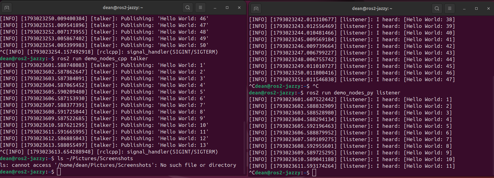
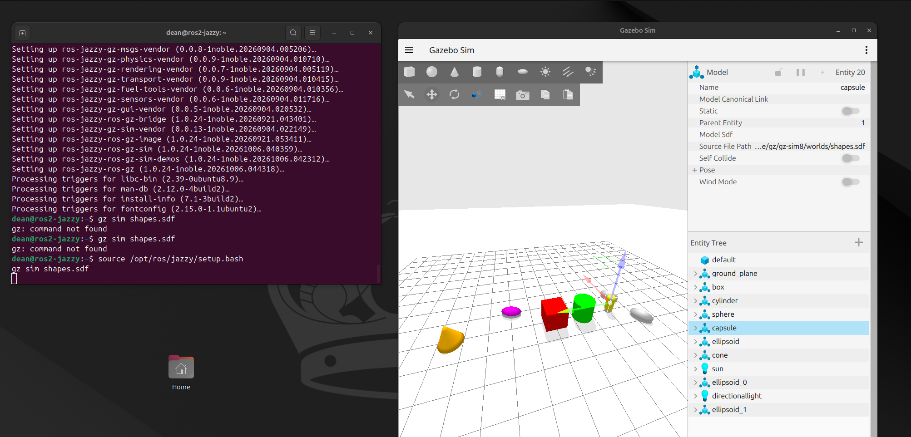
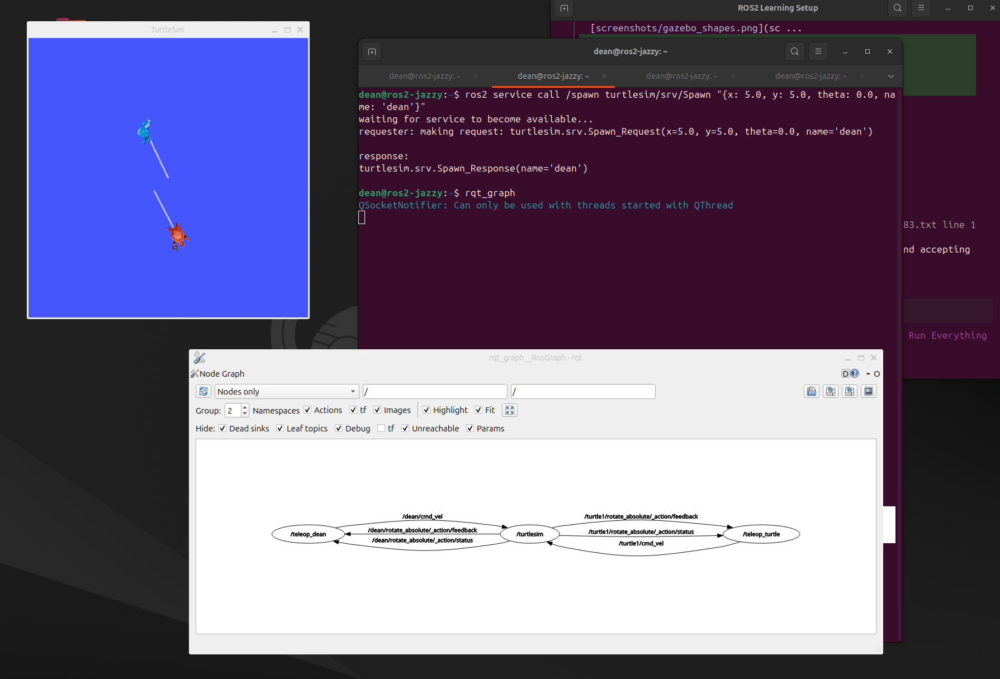
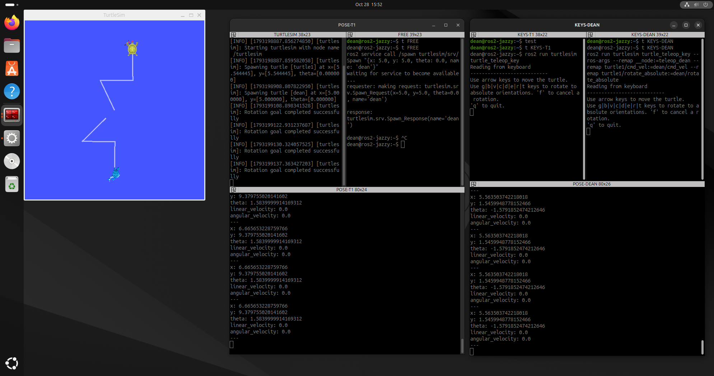
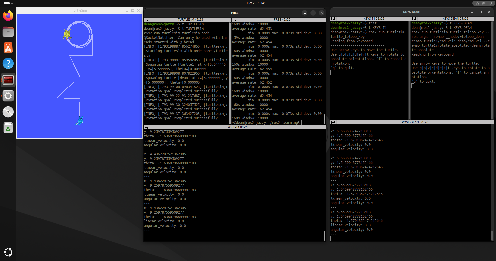
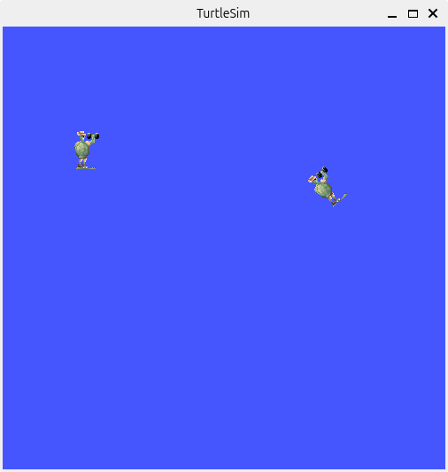
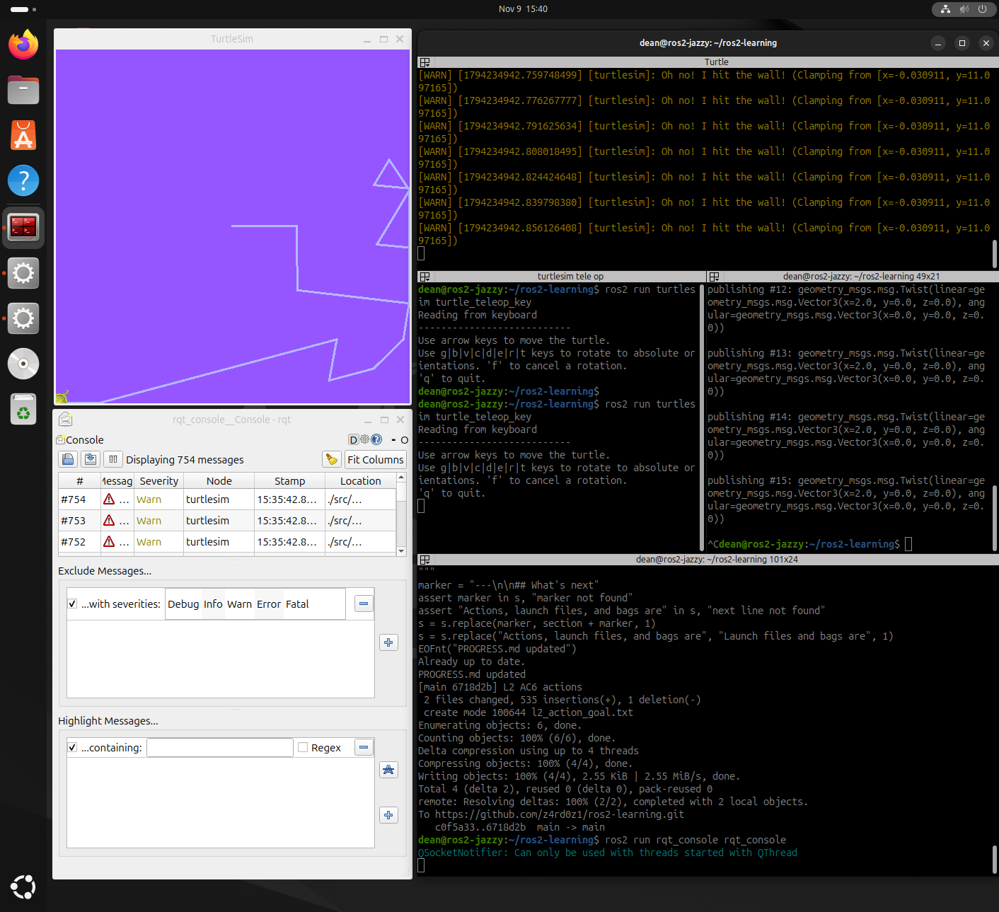
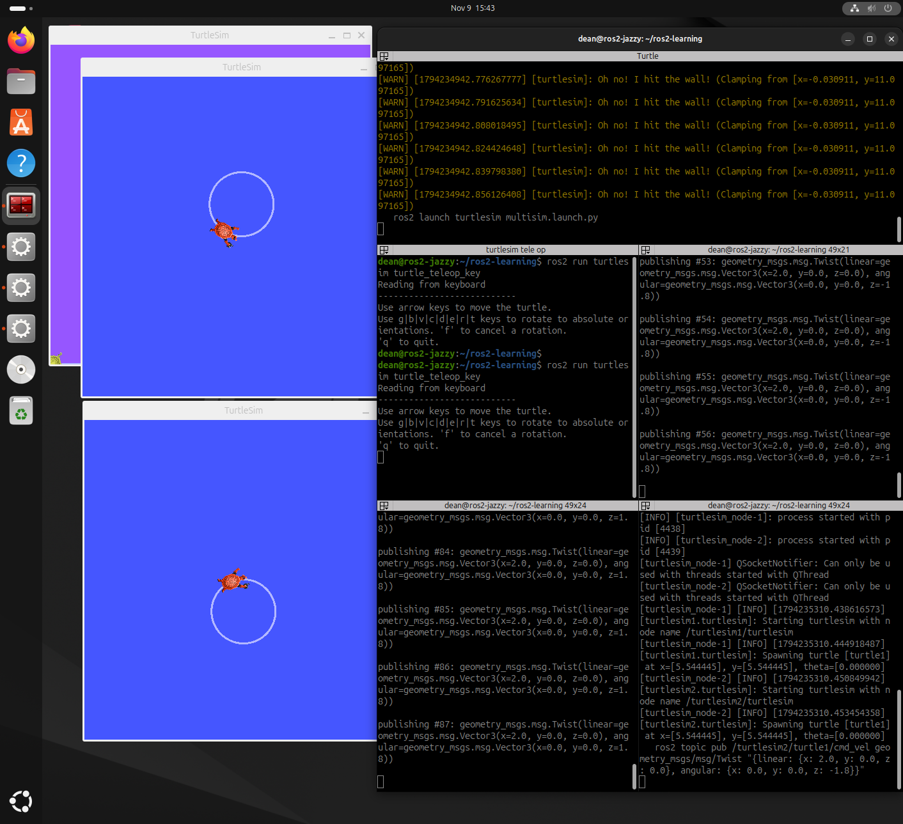

# Progress

What I've actually done so far. The [README](README.md) is the roadmap. This page is the journal.

---

## Environment

I run everything in an Ubuntu **24.04** ARM virtual machine on a Mac mini (UTM with QEMU). It has 8 GB RAM, 4 cores, 80 GB disk, and a GPU-supported display.

I installed

- **ROS 2 Jazzy**
- **Gazebo Sim 8** (Harmonic)

First proof that the stack was alive came from the classic talker / listener demo, then Gazebo with the shapes world. I knocked shapes around and added a couple of ellipsoids. Real-time factor sat around **84%**, which is solid for a VM.

---

## ROS 2 basics with turtlesim

Turtlesim is the hello-world of ROS 2. It is a blue canvas and a turtle you drive. I used it to get comfortable with nodes, topics, and the graph before touching a drone or a real robot.

### Two turtles, one simulator

I spawned a second turtle named `dean` and drove both at once, each with its own keyboard teleop in its own terminal.

The useful trick is **remapping**. The teleop program still thinks it talks to `turtle1`. I rename its topics so those messages go to `dean` instead. Same program, different turtle, no code change.

In `rqt_graph`, the boxes are nodes (running programs) and the arrows are topics. Commands go into turtlesim on `cmd_vel`. Pose and action feedback come back out.

### A workspace I can work in

After the first setup I was trying things across a pile of separate terminal windows, and I wasn't happy with the layout. I switched to Terminator for split panes, resize, and labels, and the workspace became usable. One window held turtlesim, keys for each turtle, and a live pose stream for each.

Pose (where the turtle is) and `cmd_vel` (what it's told to do) are separate topics. That split shows up everywhere later, including when something goes silent and you need to know which side broke.

### Driving without the keyboard

I also published `cmd_vel` myself from the command line (`ros2 topic pub`) and got a turtle to draw a circle. Same topic the keyboard uses. I just became the publisher.

`/turtle1/pose` ran at about **62.5 Hz**, steady to within a couple of milliseconds. `cmd_vel` was **RELIABLE** on both ends. That is worth checking with `ros2 topic info -v` when something goes quiet, because a mismatch can fail silently.

### Services

A topic is a constant stream that any node can listen to, and nothing comes back. A service is one request that always gets one answer. A drone sending out its altitude ten times a second is a topic. Telling it to take a single photo and waiting for it to confirm is a service.

I called `/clear` to wipe the trail, then `/spawn` to put a turtle named `dean` at x 2, y 8, facing up. The reply came back with its name, which is the response half of the Spawn definition.

### Parameters

A parameter is a setting you can change while a node is running. turtlesim's background colour is three of them, `background_r`, `background_g` and `background_b`, each from 0 to 255.

I set `background_r` to 150 with `ros2 param set` and the canvas turned purple straight away, with no restart. Then I saved every setting to `turtlesim.yaml` with `ros2 param dump`, restarted turtlesim with `--params-file turtlesim.yaml`, and it opened purple from the start.

### Actions

An action is a long task that reports progress while it runs and can be cancelled partway. It has three parts, the goal (`theta`, which way to face), the result (`delta`, how far it turned) and the feedback (`remaining`, how much is left).

I rotated the turtle with the letter keys and cancelled turns halfway with F. Then I sent a goal myself with `ros2 action send_goal --feedback`, watched `remaining` count down to zero, and got a result of 2.74 radians, about 157 degrees.

A robot uses an action when the job takes time and you want to watch it or stop it, like flying to a waypoint. It uses a service for a quick question with an instant answer, like asking for the battery level.

### Logs and launch files

Every ROS node reports what it is doing as log messages, from routine info up to warnings and errors. rqt_console collects them all in one window where you can filter and search them.

I drove the turtle into the wall with `ros2 topic pub` and the console filled with turtlesim's "Oh no! I hit the wall!" warnings, 754 of them, because it checks its position 62.5 times a second.

A launch file starts several nodes with one command. `ros2 launch turtlesim multisim.launch.py` opened two turtlesims, each in its own namespace, `turtlesim1` and `turtlesim2`, so their topics don't clash. I drove them in opposite circles by publishing to each one's own `cmd_vel`.

---

## What's next

Bags are still on turtlesim. After that come my own Python nodes.
