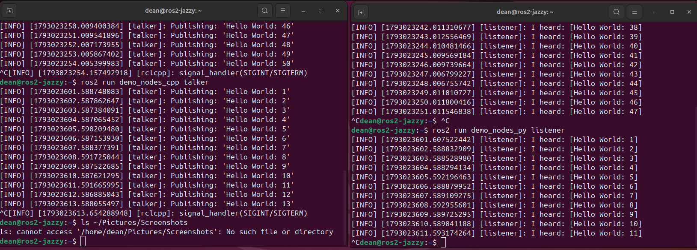
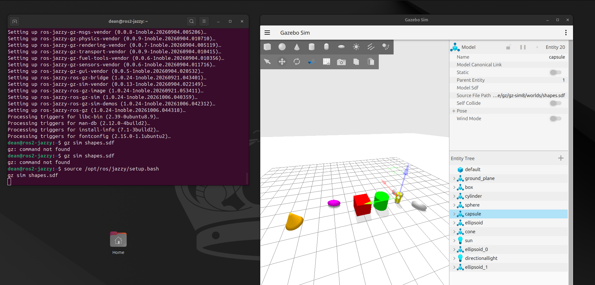
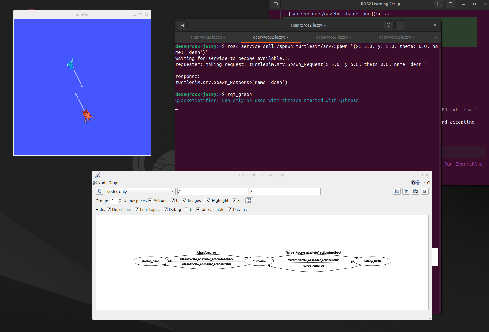
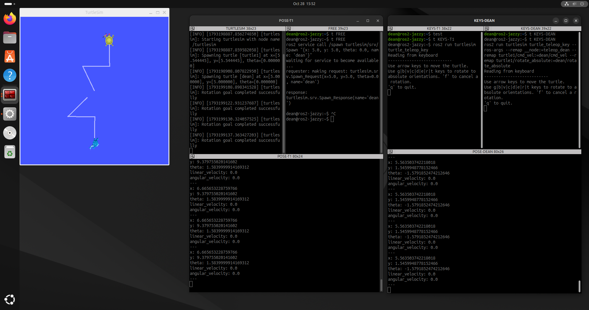
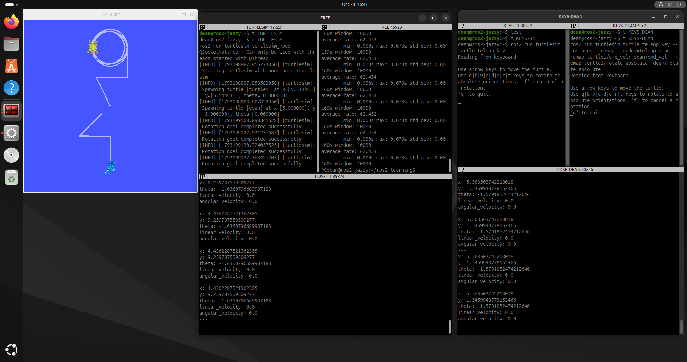

# Progress

What I've actually done so far. The [README](README.md) is the roadmap. This page is the journal.

---

## Environment

I run everything in an Ubuntu **24.04** ARM virtual machine on a Mac mini (UTM with QEMU). It has 8 GB RAM, 4 cores, 80 GB disk, and a GPU-supported display.

I installed

- **ROS 2 Jazzy**
- **Gazebo Sim 8** (Harmonic)

First proof that the stack was alive came from the classic talker / listener demo, then Gazebo with the shapes world. I knocked shapes around and added a couple of ellipsoids. Real-time factor sat around **84%**, which is solid for a VM.

---

## ROS 2 basics with turtlesim

Turtlesim is the hello-world of ROS 2. It is a blue canvas and a turtle you drive. I used it to get comfortable with nodes, topics, and the graph before touching a drone or a real robot.

### Two turtles, one simulator

I spawned a second turtle named `dean` and drove both at once, each with its own keyboard teleop in its own terminal.

The useful trick is **remapping**. The teleop program still thinks it talks to `turtle1`. I rename its topics so those messages go to `dean` instead. Same program, different turtle, no code change.

In `rqt_graph`, the boxes are nodes (running programs) and the arrows are topics. Commands go into turtlesim on `cmd_vel`. Pose and action feedback come back out.

### A workspace I can work in

After the first setup I was trying things across a pile of separate terminal windows, and I wasn't happy with the layout. I switched to Terminator for split panes, resize, and labels, and the workspace became usable. One window held turtlesim, keys for each turtle, and a live pose stream for each.

Pose (where the turtle is) and `cmd_vel` (what it's told to do) are separate topics. That split shows up everywhere later, including when something goes silent and you need to know which side broke.

### Driving without the keyboard

I also published `cmd_vel` myself from the command line (`ros2 topic pub`) and got a turtle to draw a circle. Same topic the keyboard uses. I just became the publisher.

`/turtle1/pose` ran at about **62.5 Hz**, steady to within a couple of milliseconds. `cmd_vel` was **RELIABLE** on both ends. That is worth checking with `ros2 topic info -v` when something goes quiet, because a mismatch can fail silently.

---

## What's next

Services, parameters, actions, launch files, and bags are still on turtlesim. After that come my own Python nodes.
